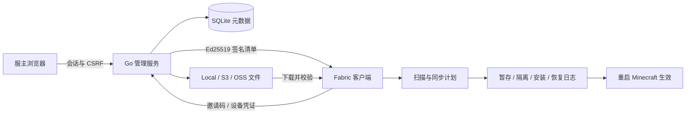
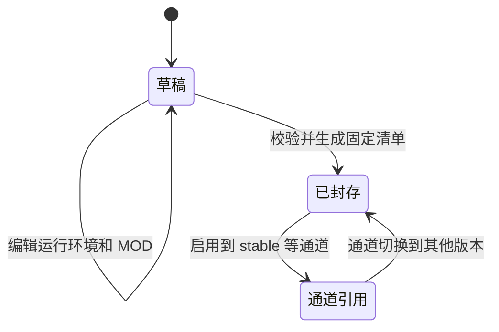

# 技术架构

[文档首页](README.md) · [协议与 API](API.md) · [开发指南](DEVELOPMENT.md)

## 系统边界

本项目不启动 Minecraft 服务端，也不替启动器安装游戏、Java 或 Loader。Go 服务是控制和文件分发服务，Fabric MOD 是玩家侧环境管理器。

## 服务端模块

| 目录 | 职责 |
| --- | --- |
| `server/cmd/mod-list-discovery-server` | init、serve、version、密码重置 CLI |
| `server/internal/app` | 路由、管理 API、公开 API、依赖检查、发布事务 |
| `server/internal/auth` | 密码哈希、会话和令牌辅助 |
| `server/internal/database` | SQLite schema 与连接 |
| `server/internal/artifact` | JAR 元数据校验、URL 导入和目标地址限制 |
| `server/internal/signing` | Ed25519 密钥、信封签名 |
| `server/internal/storage` | Local、S3、OSS 存储适配 |
| `server/internal/webui` | Go embed HTML、Bootstrap 和原生 JavaScript |

浏览器界面用共享组件处理表单、弹窗、列表和消息；API 提供的文本以 `textContent` 插入，避免当作 HTML 执行。前端资源本地内嵌，没有运行时 CDN 依赖。后台状态和操作始终由服务端校验，按钮禁用不是权限机制。

## 核心对象与生命周期

Server 组织一组环境版本、分发通道和设备授权。Artifact 是按 SHA256 标识的不可变文件；相同文件可被多份版本引用。Release 包含 MOD 规则和运行环境要求：

封存后的 Release 内容不可变。通道是指向某个已封存版本的可变引用，切换到旧版本即可让玩家下次获取旧清单。它不是世界存档回滚。引用中的文件不能删除，已有封存版本的服务器不能删除。

## 信任与授权

管理员密码使用 Argon2id；后台通过 HttpOnly / SameSite 会话 Cookie 认证，修改请求检查 CSRF token，HTTPS 部署使用 Secure Cookie。签名私钥保存在服务端数据目录，不返回到后台设置页。

私密服务器的邀请码用于首次登记，数据库存储邀请码/设备令牌的哈希。登记后客户端保存设备凭证；撤销邀请码不撤销已登记设备。下载接口同时验证设备权限与文件在该服务器已封存版本中的归属。

客户端首次连接固定服务器公钥，后续改变必须显式重新信任。清单签名验证针对解码后的原始 payload 字节，不能重新序列化 JSON 后再验证。

跨 origin 下载重定向不转发 Authorization，并拒绝 HTTPS 降级；URL 导入对 DNS 解析结果和重定向目标进行检查。SHA256 校验确保内容一致，不代替 MOD 的来源审查与分发授权。

## 客户端模块与同步事务

客户端位于 `client/src/main/java/org/modlistdiscovery/client`：

| 模块 | 职责 |
| --- | --- |
| `ModListDiscoveryClient`、`ui/DiscoveryScreen` | 游戏入口与交互界面 |
| `core/Engine` | 环境配置、网络请求和同步协调 |
| `core/ManifestVerifier` | 签名与清单结构校验 |
| `core/Scanner`、`core/Planner` | 本地 MOD 扫描、版本要求检查、差异计划 |
| `core/FilesEx`、`core/Models` | 文件操作与数据结构 |

顺序为获取清单 → 验签和检查运行环境 → 扫描 → 用户确认计划 → 下载到暂存区并校验 → 记录事务 → 隔离/安装 → 更新状态 → 提示重启。下载未全部成功前不修改正式 MOD 目录。

状态文件通过临时文件、fsync 和原子替换保存；损坏 JSON 会保留原文件并阻止修改。未完成事务进入恢复模式。进程内操作锁与文件锁限制并发写入，其他实例进入只读模式。

网络、哈希和 ZIP 操作在后台线程执行，避免阻塞游戏渲染。多个 Profile 共享实例 MOD 目录，实际应用时重新计算环境差异。

## 约束与扩展

依赖检查不是完整 Fabric 求解器；“检查通过”不保证任意第三方 MOD 组合能成功启动。云存储签名测试也不替代真实 bucket 的部署验收。

新增 Minecraft 兼容版本需要修改依赖和相应游戏 API 适配，并执行客户端测试、服务端互通及真实游戏启动测试；不能仅扩大 `fabric.mod.json` 的版本范围。签名协议变化应更新 schema 和双方验证逻辑，不能悄悄更改已有版本语义。
